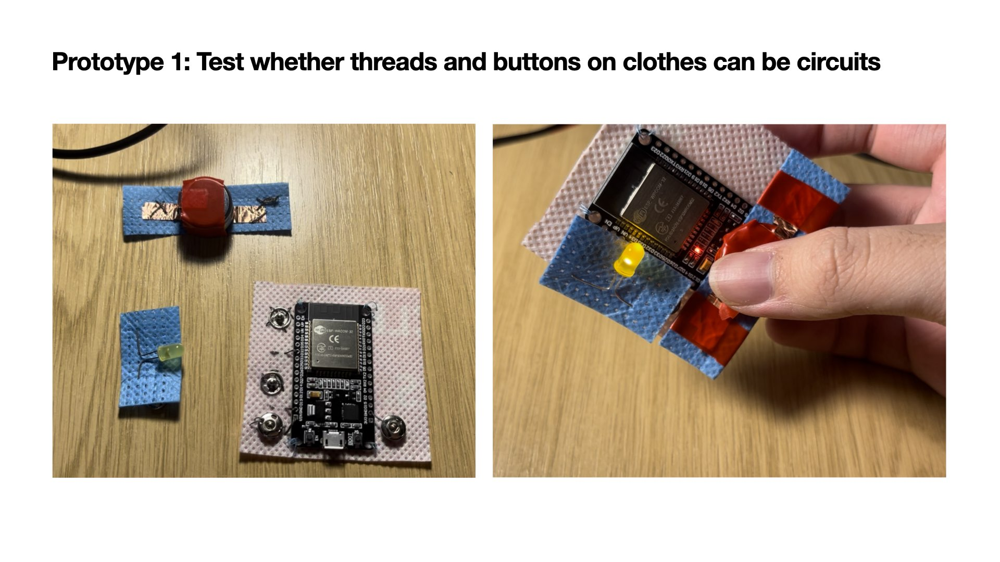
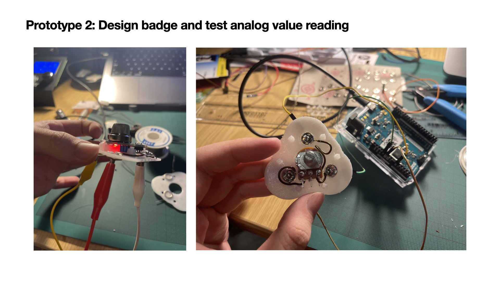
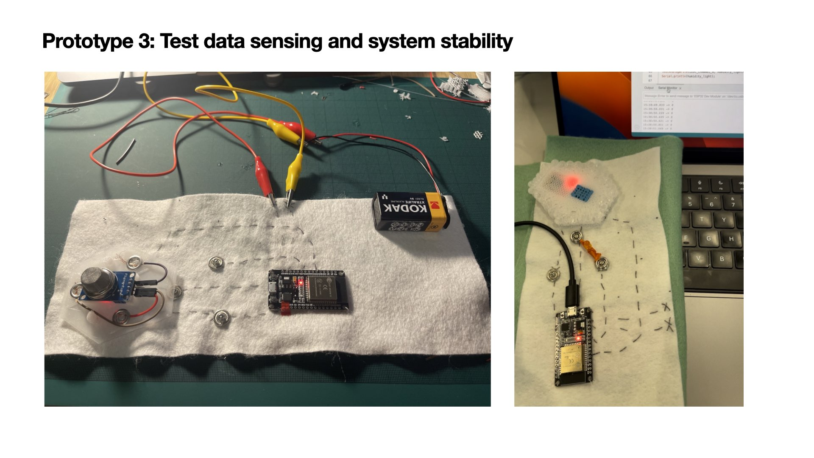
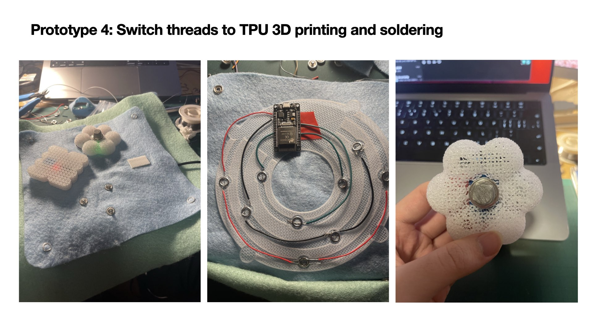
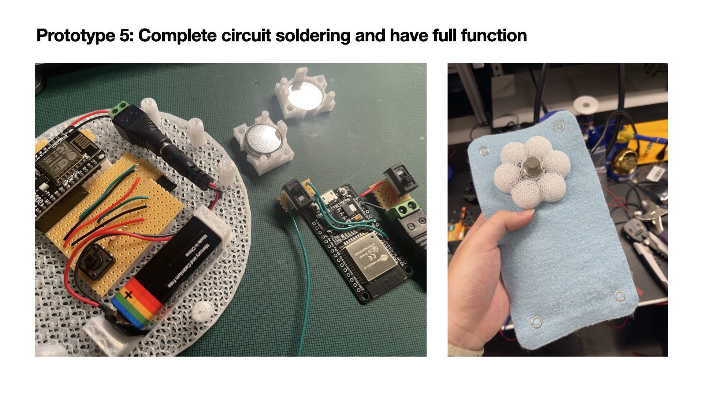

# Decentralized Sensing Badges

Decentralized Sensing Badges is a wearable physical-computing project for community-led environmental sensing and data sharing. Each badge acts as a small sensing probe: it collects environmental information, sends the reading wirelessly to a nearby station, and expresses the data through a physical light display.

The project explores how low-cost electronics, personal fabrication, and wearable design can support decentralized data collection. The badge is designed as both a sensing device and a personal object, allowing environmental data collection to become visible, accessible, and connected to individual expression.

## System overview

The prototype has two wireless nodes:

1. **Badge node** — an ESP8266 reads an MQ135 air-quality sensor and sends an air-quality-related value over ESP-NOW.
2. **Station node** — a second ESP8266 receives the value and maps it to the brightness and color of a 14-pixel NeoPixel ring.

A button on each node controls the interaction. The badge and station sketches contain fixed peer MAC addresses that must be updated for the two devices being used.

## Repository contents

| Directory | Contents |
|---|---|
| [`01_prototype_code/`](01_prototype_code/) | Arduino sketches used by the working prototype |
| [`02_model_sources/`](02_model_sources/) | Rhino 3D modeling source files |
| [`03_3d_print_files/`](03_3d_print_files/) | STL meshes ready to import into a 3D-printing slicer |
| [`04_development_reference_code/`](04_development_reference_code/) | Earlier communication experiments and course sketches |
| [`05_circuit_documentation/`](05_circuit_documentation/) | Photos documenting circuit construction and prototype testing |

### Prototype Arduino code

| File | Description |
|---|---|
| [`01_prototype_code/badge_send/badge_send.ino`](01_prototype_code/badge_send/badge_send.ino) | Badge node. Reads MQ135 data and sends it with WifiEspNow. |
| [`01_prototype_code/station_recieve/station_recieve.ino`](01_prototype_code/station_recieve/station_recieve.ino) | Station node. Receives the value and drives the NeoPixel ring. |

The filename `station_recieve.ino` keeps the spelling used in the original project.

### 3D modeling and printing files

| File | Description |
|---|---|
| [`02_model_sources/base.3dm`](02_model_sources/base.3dm) | Base or enclosure model. |
| [`02_model_sources/Badge.3dm`](02_model_sources/Badge.3dm) | Main badge model. |
| [`02_model_sources/Badge_test.3dm`](02_model_sources/Badge_test.3dm) | Test badge model. |
| [`03_3d_print_files/Badge_Circle.stl`](03_3d_print_files/Badge_Circle.stl) | Circular badge mesh for slicing. |
| [`03_3d_print_files/Badge_test.stl`](03_3d_print_files/Badge_test.stl) | Test badge mesh for slicing. |

The repository includes STL meshes rather than printer-specific G-code. Import an STL into the slicer for the target printer, configure the material, layer height, infill, supports, and build plate, then export the required machine file.

### Circuit and prototype documentation

The project does not contain a formal schematic or PCB layout. The following photos document the physical circuit design process and the main prototype tests:

| File | What it shows |
|---|---|
| [`prototype_01_textile_button_circuit.jpeg`](05_circuit_documentation/prototype_01_textile_button_circuit.jpeg) | Testing conductive textile, buttons, LEDs, and an ESP32 board. |
| [`prototype_02_badge_analog_reading.jpeg`](05_circuit_documentation/prototype_02_badge_analog_reading.jpeg) | Testing the badge form and analog sensor readings. |
| [`prototype_03_sensor_system_test.jpeg`](05_circuit_documentation/prototype_03_sensor_system_test.jpeg) | Testing the sensor, battery, textile connections, and system stability. |
| [`prototype_04_tpu_wearable_circuit.jpeg`](05_circuit_documentation/prototype_04_tpu_wearable_circuit.jpeg) | Moving from textile experiments to TPU 3D-printed wearable circuits. |
| [`prototype_05_soldered_badge_circuit.jpeg`](05_circuit_documentation/prototype_05_soldered_badge_circuit.jpeg) | Completed soldered circuit and assembled wearable badge. |

  
  

  
  

  

## Hardware and software

### Hardware

- Two ESP8266 boards
- MQ135 air-quality sensor
- 14-pixel NeoPixel ring
- One button for the badge node
- One button for the station node
- 3D-printed badge enclosure

### Pin assignments in the prototype sketches

- Badge MQ135 sensor: GPIO13 / D7
- Badge button: GPIO14 / D5
- Station NeoPixel ring: GPIO13 / D7
- Station button: GPIO14 / D5

### Arduino libraries

Install the ESP8266 board package and these libraries before compiling:

- `WifiEspNow`
- `MQ135`
- `Adafruit NeoPixel`

## Running the prototype

1. Install the ESP8266 board package and the libraries listed above.
2. Open `badge_send/badge_send.ino` and `station_recieve/station_recieve.ino` in the Arduino IDE.
3. Read each board's MAC address from the serial output.
4. Replace the `PEER` address in each sketch with the MAC address of the other board.
5. Flash both sketches and power the two nodes on the same ESP-NOW channel.
6. Press the station button to display the received environmental value through the NeoPixel ring.

## Project video

[Watch the project demonstration video on YouTube](https://www.youtube.com/watch?v=fy3ZHzJYr6A&t=1s)
